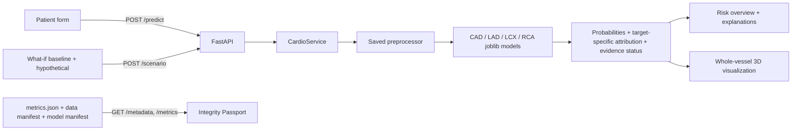

# Architecture and Data Flow

CardioLens is a local React/TypeScript frontend, FastAPI backend, scikit-learn inference pipeline, and procedural Three.js scene. It is a synthetic-data research demonstration.

## Components

- `ml/schema.py` normalizes column names and identifies outcome leakage fields.
- `ml/preprocessor.py` removes direct outcome fields, imputes/scales numerical fields, and imputes/encodes categorical fields.
- `ml/train.py` performs per-target candidate comparison under stratified CV, selects by pooled out-of-fold F1, fits final demo estimators on the full dataset, and writes metrics/manifests/artifacts.
- `backend/app/schemas.py` validates numeric ranges, categorical options, and rejects unknown keys. `/predict` performs four outputs, `/scenario` evaluates two profiles, `/explain` returns target explanations, and `/metadata` serves generated provenance/evaluation metadata.
- `frontend/src/App.tsx` coordinates active prediction, tab state, vessel selection, and scenario outputs. API responses feed both risk cards and the 3D viewer.
- `frontend/src/components/HeartViewer3D.tsx` constructs procedural heart/rib/vessel geometry. Colors represent probability bands only; anatomy is not patient-specific.

## Important boundaries

The backend loads fixed repository-local model artifacts, not paths supplied by clients. CORS allows the local development origins. No patient identity is included in the demo form. This repository does not claim clinical-grade privacy, availability, calibration, out-of-distribution detection, or safety certification.

Training metrics are pooled cross-validation predictions used for candidate selection and are not an independent test. The final fit uses all bundled synthetic rows. A separate external dataset, source review, and held-out evaluation are still required before making generalization claims.
